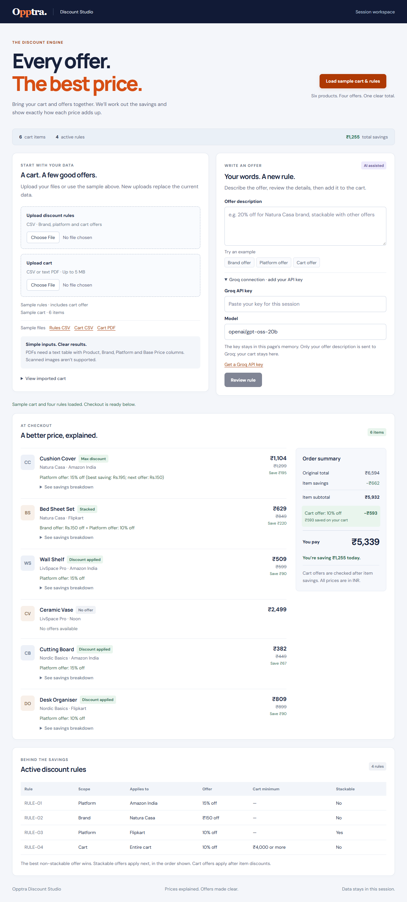

# Opptra Discount Engine

A checkout workspace that compares brand and platform offers, stacks eligible savings, and shows the price a customer actually pays. Built on [Opptra's React/Vite starter](https://github.com/opptra/discount-engine-assignment).

**Live demo:** Pending deployment. Add your deployed URL here before submitting.

**Walkthrough:** Pending recording. Add your Loom URL here after recording on the live deployment.

## Run locally

Use Node 24 (see `.nvmrc`). From this project folder:

1. Install dependencies: `npm ci`
2. Start the app: `npm run dev`

Open [localhost:5173](http://localhost:5173) and select **Load sample cart & rules**. You can calculate discounts and import PDFs without an API key.

## What works

- **Item discounts:** choose the non-stackable rule with the biggest rupee saving, then apply stackable offers. Each product shows its final price, savings, and an explanation.
- **Cart offers:** check the subtotal after item discounts, show eligible cart offers separately, and calculate the final amount to pay. The offer row disappears when the threshold is not met.
- **Plain-English rules:** Groq converts a description into a structured rule. Validation and a field-by-field review happen before **Confirm and add rule** changes the active rules. **Discard** leaves checkout alone.
- **CSV and PDF carts:** uploads replace the current cart and recalculate it with the active rules. Invalid imports keep the previous cart and show the offending row.

The app uses in-memory state. Refreshing clears the workspace. No database or server is needed.

<details>
<summary>See the sample checkout</summary>



</details>

## Try the AI rule input

Open **Groq connection**, enter your own [Groq API key](https://console.groq.com/keys), and describe one offer. The key stays in page memory; it is not saved in browser storage or the repository. The description is sent directly to Groq. Cart files are processed locally.

The default model is `openai/gpt-oss-20b`, served through Groq with [strict structured outputs](https://console.groq.com/docs/structured-outputs). You can choose another Groq model that supports strict JSON schema output in the connection settings, or set the optional public model name using `VITE_GROQ_MODEL` in `.env.local` (see `.env.example`). Never put an API key in a `VITE_*` variable: those values are included in browser code.

Try these descriptions:

```text
20% off for Natura Casa brand, stackable with other offers
Rs.100 flat discount on all Flipkart items
10% off if cart value is more than Rs.5,000
```

“Give a discount for big orders” should ask for a discount percentage and a cart minimum. Ambiguous or unsupported conditions are not meant to become active rules. A bad provider response is rejected locally. There is no simulated parser standing in for the LLM.

## Sample checkout

| Item           | Base price | Final item price | Applied offer                         |
| -------------- | ---------: | ---------------: | ------------------------------------- |
| Cushion Cover  |     ₹1,299 |           ₹1,104 | Amazon 15% beats the ₹150 brand offer |
| Bed Sheet Set  |       ₹849 |             ₹629 | ₹150 brand saving, then Flipkart 10%  |
| Wall Shelf     |       ₹599 |             ₹509 | Amazon 15%                            |
| Ceramic Vase   |     ₹2,499 |           ₹2,499 | No offers available                   |
| Cutting Board  |       ₹449 |             ₹382 | Amazon 15%                            |
| Desk Organiser |       ₹899 |             ₹809 | Flipkart 10%                          |

**Item subtotal: ₹5,932. Cart offer: −₹593. Final cart total: ₹5,339.**

The calculator keeps the starter's whole-rupee rounding: round each saving, then subtract it. A cart offer uses the item subtotal and an inclusive minimum (`>=`). Flat discounts cannot push a price below zero. Ties keep the earlier rule. Multiple stackable offers run in file order. The reasoning and tradeoffs are in [docs/DECISIONS.md](docs/DECISIONS.md).

## Input files

Both CSV formats use a header row. Names may contain spaces; quote fields containing commas. Monetary fields use whole rupees without separators or currency symbols. Percentages may have two decimal places.

`rules.csv`:

```csv
rule_id,scope,applies_to,type,value,stackable,min_cart_value
RULE-01,platform,Amazon India,percentage,15,false,
RULE-02,brand,Natura Casa,flat,150,false,
RULE-03,platform,Flipkart,percentage,10,true,
RULE-04,cart,,percentage,10,false,4000
```

Cart rules have a blank `applies_to`, a percentage discount, and a `min_cart_value`. The starter's original six-column format still works for item rules.

`cart.csv`:

```csv
item_id,product,brand,platform,base_price
ITEM-01,Cushion Cover,Natura Casa,Amazon India,1299
```

A cart PDF needs a selectable-text table with **Product, Brand, Platform, Base Price** in that order. Use single-line, left-aligned cells and repeat the header on each page. Prices such as `Rs.1,299`, `₹1,299`, or `1299` are accepted. Image scans and wrapped cells are outside the supported format. PDFs get new item IDs because the required table has no ID column.

The [sample-data](sample-data) folder contains a valid PDF, a two-page PDF, a malformed PDF, and carts at ₹3,999 and ₹4,000 for checking the threshold. `expected-results.json` contains the full sample breakdown. To regenerate the fixtures and public downloads, run `npm run samples`.

## Checks

```bash
npm run check                 # unit tests and production build
npx playwright install chromium
npm run test:e2e              # tests the built app; Groq responses are stubbed
```

Unit tests cover pricing, stacking, threshold boundaries, CSV validation, PDF table extraction, and the Groq request/response boundary. Browser tests cover uploads, PDF replacement, confirmation/discard, ambiguity, invalid model output, and the mobile layout. These automated suites do not spend API quota.

To check the actual provider, set `GROQ_API_KEY` in your shell and run `npm run test:groq`. Alternatively, run `node scripts/check-groq.mjs --stdin-key` and paste the key at the hidden terminal prompt. The script checks all three assignment examples and ambiguous input, without printing or saving the key. It makes four real API calls, so your Groq usage limits apply.

Verified on 23 November 2026: all four live Groq checks passed with `openai/gpt-oss-20b`. A separate live browser check also parsed an offer, reviewed it, confirmed it, and recalculated the checkout successfully. The regular test suite passed 65 unit tests and 8 browser tests, and the production build completed successfully. API access and quota are tied to the key used for a session.

GitHub Actions runs both suites on pushes and pull requests. Test traces are uploaded when a browser test fails.

Use `npm run format` after editing to keep the source and documentation consistent.

## How the files fit together

```text
src/
  engine/           # Pricing and shared validation; no UI or network calls
  inputs/           # PDF extraction and Groq rule adapter
  components/       # Uploads, rule review, tables and errors
  App.jsx           # Session state and checkout display
sample-data/        # CSV/PDF fixtures and expected checkout JSON
public/samples/     # Downloadable files used by the app
tests/              # Unit and adapter tests
e2e/                # Browser tests
scripts/            # Rebuild the sample PDFs and expected result file
docs/               # Design decisions and submission steps
.github/            # CI and pull request template
```

CSV parsing remains at the starter's `src/engine/csvParser.js` path. All adapters produce the same validated objects; adding a new input mode does not require changing pricing logic.

## Deploy and submit

Push to your fork of the original assignment repository. Import that fork into Vercel or Netlify; both hosting configuration files are included. The build command is `npm run build`, the output folder is `dist`, and Node 24 is recommended. No secret environment variables are needed for this bring-your-own-key prototype.

After deployment, add the real live URL and walkthrough link at the top of this README. [docs/SUBMISSION.md](docs/SUBMISSION.md) includes the push commands, a live-site checklist, and a short recording outline. Those links are intentionally pending until the corresponding deployment and recording exist.

For a shared production service, move the LLM call behind an authenticated, rate-limited endpoint instead of distributing a company API key. This assignment stays client-side and session-only as requested.
